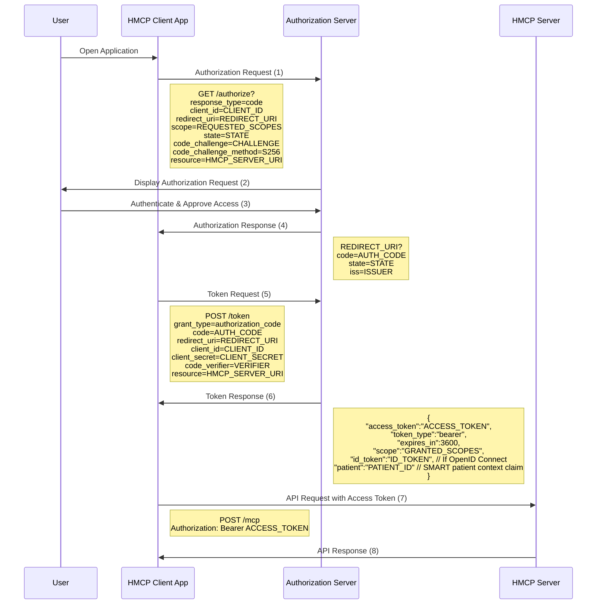
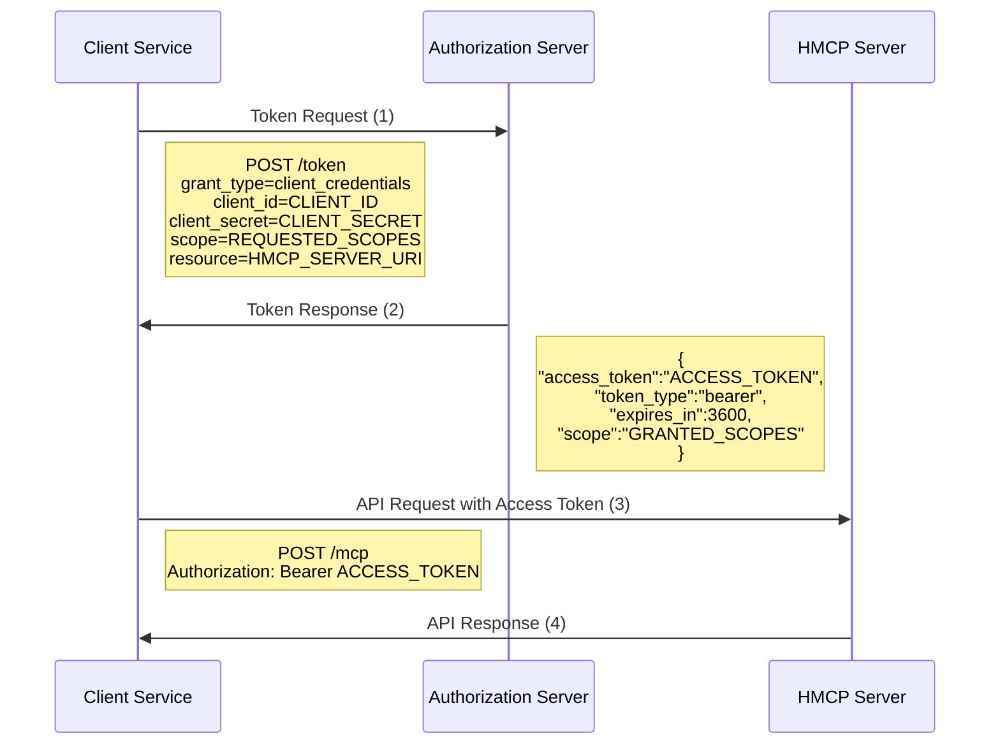

# Authentication, authorization, and scopes

HMCP adopts the SMART on FHIR authentication and authorization framework, which
builds upon OAuth 2.0 and OpenID Connect. Because HMCP runs over HTTP
(streamable HTTP), it also follows the base MCP authorization rules for the
`2026-07-28` revision. This document describes both frameworks and states where
the HMCP SDK implements less than the protocol requires.

## Base MCP 2026-07-28 authorization

**Normative.** The MCP authorization specification
([Authorization](https://modelcontextprotocol.io/specification/2026-07-28/basic/authorization))
applies to HTTP-based transports. It builds on OAuth 2.1 and these RFCs:

* **Roles.** A protected MCP server is an OAuth 2.1 *resource server*; an MCP
  client is an OAuth 2.1 *client*.
* **Protected Resource Metadata (RFC 9728).** MCP servers **MUST** implement
  OAuth 2.0 Protected Resource Metadata, and MCP clients **MUST** use it for
  authorization-server discovery.
* **Resource indicators (RFC 8707).** MCP clients **MUST** include a `resource`
  parameter identifying the MCP server in both authorization and token requests.
  MCP servers **MUST** validate that an access token was issued for them as the
  intended audience.
* **Issuer identification (RFC 9207).** Clients **MUST** record the issuer from
  the authorization server's validated metadata and compare it with the `iss`
  parameter in the authorization response before sending the code to the token
  endpoint.
* **Client registration.** Authorization servers and clients **SHOULD** support
  OAuth Client ID Metadata Documents (CIMD,
  [draft-ietf-oauth-client-id-metadata-document](https://datatracker.ietf.org/doc/html/draft-ietf-oauth-client-id-metadata-document-00)).
  Dynamic Client Registration (DCR, RFC 7591) is **deprecated** and retained
  only for backwards compatibility with authorization servers that do not
  support CIMD.
* **Bearer tokens.** Clients send `Authorization: Bearer <token>` on every
  request; tokens **MUST NOT** appear in the URI query string.

## Current HMCP SDK behavior

**SDK behavior.**

* **Audience binding is on by default.** `HMCPServer`
  (`src/hmcp/server/hmcp_server.py`) re-validates a supplied `AuthSettings` with
  `validate_token_resource=True` when a `resource_server_url` is present and no
  explicit value was given, so RFC 8707 audience binding is enforced. Supplying
  `auth` without `resource_server_url` raises `ValueError`; supplying
  `validate_token_resource=False` keeps that value (the `TokenVerifier` is then
  responsible for checking the audience). Constructing `AuthSettings` directly
  with `validate_token_resource` unset emits `MCPDeprecationWarning`.
* **The mcp 2.3.0 server serves Protected Resource Metadata.** `HMCPServer`
  subclasses `mcp.server.mcpserver.MCPServer`, which mounts the RFC 9728
  protected-resource-metadata route (mcp 2.3.0,
  `mcp/server/auth/routes.py`). HMCP adds no discovery of its own.
* **`OAuthClient`** (`src/hmcp/shared/auth/oauth_client.py`) discovers endpoints
  from RFC 8414 authorization-server metadata at
  `/.well-known/oauth-authorization-server`, and supports the client-credentials,
  authorization-code (with PKCE S256), refresh and revocation flows.
* **`register_client` is DCR.** `OAuthClient.register_client` POSTs an RFC 7591
  client-metadata JSON body (a plain dict with `redirect_uris`, `grant_types`,
  …) to the discovered `registration_endpoint`
  (`src/hmcp/shared/auth/oauth_client.py`). This is exactly the Dynamic Client
  Registration that the 2026-07-28 base spec **deprecates** in favor of CIMD;
  use it only with authorization servers that do not support CIMD.
* **Gaps.** `OAuthClient` does **not** send the RFC 8707 `resource` parameter on
  its authorization or token requests, and does **not** validate the RFC 9207
  `iss` parameter in the authorization response. `parse_authorization_response`
  returns only `code` and `state`; it does verify the `state` (RFC 6749 §10.12)
  when the caller passes the value from `start_authorization_code_flow` as
  `expected_state`, raising `InvalidStateError` on a missing or mismatched state.
  A deployment that needs the `resource` or `iss` guarantees must add them or
  use an RFC 8707/9207-conformant client.

## Authentication flows

HMCP supports two primary authentication flows:

### 1. OAuth 2.0 authorization code flow (user-mediated)

Used when an application needs to access data on behalf of a user. This flow
requires user consent and authentication.



**Normative.** The client records the issuer from the authorization server's
metadata and validates the `iss` value in step (4) against it (RFC 9207) before
the token request. The `resource` parameter is sent on both the authorization
and token requests (RFC 8707), and the server rejects a token whose audience is
not itself.

### 2. Client credentials flow (service-to-service)

Used for server-to-server authentication with no user involvement, typically
with additional security such as mTLS.



**SDK behavior.** `OAuthClient.get_client_credentials_token` requests the token
from the discovered endpoint, trying `/token/m2m` first and falling back to the
canonical `/token` (`src/hmcp/shared/auth/oauth_client.py`). It does not send a
`resource` parameter.

## Scopes in HMCP

HMCP uses scopes to control access permissions, following SMART on FHIR
conventions:

### Scope format

SMART on FHIR scopes follow this grammar:

```
[patient|user|system]/<resource>.<permissions>
```

Where:

* `patient`, `user` or `system` (optional prefix): the context the scope applies
  to
* `<resource>`: the FHIR resource type, or `*`
* `<permissions>`: one or more of `c`, `r`, `u`, `d`, `s`

For example `patient/Observation.rs`, `user/Patient.read` and `system/*.read`.

### Standard scopes

HMCP also uses scope strings that do **not** follow that grammar. The table
below labels each one's kind:

| Scope | Kind | Description |
|-------|------|-------------|
| `hmcp:access` | HMCP-specific | Basic access to HMCP services |
| `hmcp:read` | HMCP-specific | Read access to HMCP resources |
| `hmcp:write` | HMCP-specific | Write access to HMCP resources |
| `patient/hmcp:read` | HMCP-specific | Read access limited to the current patient context |
| `patient/hmcp:write` | HMCP-specific | Write access limited to the current patient context |
| `openid` | OpenID Connect | Authentication using OpenID Connect |
| `profile` | OpenID Connect | Access to basic user profile information |
| `launch/patient` | SMART launch | Request patient context at launch time |
| `offline_access` | OAuth 2.0 | Request a refresh token for offline access |

**SDK behavior.** HMCP's SDK parses no scope grammar; it passes scopes through
as opaque strings. The only scope literal in `src/` is `hmcp:access`
(`src/hmcp/shared/auth/oauth_client.py`).

## Patient context

Patient identity is carried by the token, not by scopes alone. In SMART on FHIR
the authorization server returns a `patient` claim identifying the one patient
the token is bound to, and a `patient/`-prefixed scope restricts access to that
patient. The `patient` claim is a **ceiling**: no operation performed with the
token may reach a patient other than the one named there.

HMCP 0.1.0 carries the patient *context* (the patient reference, encounter,
purpose of use and lifetime) out of band through the
`com.innovaccer/hmcp-patient-context` extension, and requires patient-scoped
tools to fail closed without an opened context. The token's SMART `patient`
claim remains the upper bound the extension must not exceed. See
[patient-context.md](./patient-context.md) for the mechanism, the extension
methods (`hmcp/patientContext/open`, `.../get`, `.../close`) and the error
codes.

## OpenID Connect integration

**Normative / deployment-level.** A conforming SMART on FHIR deployment may use
OpenID Connect for user authentication, with these features:

1. **ID Token**: contains claims about user authentication and basic user identity
2. **UserInfo Endpoint**: provides additional user attributes when requested
3. **Standard Claims**: includes SMART on FHIR and healthcare-specific claims in tokens

To use OpenID Connect, include the `openid` scope in the authorization request
along with any additional profile scopes.

**SDK behavior.** HMCP's SDK performs no ID-token validation and makes no
UserInfo call. `OAuthClient` parses the token endpoint response into an
`OAuthToken`, which carries no `id_token` field
(`src/hmcp/shared/auth/oauth_client.py`); a deployment that needs ID-token or
UserInfo handling must add it.

## JWT format and claims

HMCP access tokens are JWTs with these standard claims:

```json
{
  "iss": "https://authorization-server.example.com",
  "sub": "user-or-client-id",
  "aud": "https://hmcp-server.example.com",
  "exp": 1656086400,
  "iat": 1656082800,
  "scope": "hmcp:read patient/hmcp:write",
  "patient": "test-0001",
  "tenant": "organization-id",
  "acr": "level-of-assurance",
  "fhirUser": "Practitioner/test-0001"
}
```

**Normative.** `aud` identifies the MCP server as the intended audience and
**MUST** be validated by the server (RFC 8707); HMCP enforces this by default
through `validate_token_resource`. `iss` identifies the authorization server.
`patient` is the SMART patient claim and acts as the access ceiling described
above.

**SDK behavior.** HMCP derives the caller's principal from the validated token
through the mcp server's auth middleware:
`hmcp.server.patient_context.extension` calls
`mcp.server.auth.middleware.auth_context.get_access_token`, and
`Principal.from_access_token` in `src/hmcp/shared/types.py` reads the client id,
issuer and subject via `mcp.server.auth.provider.principal_components`.

## Token storage and security

Clients must securely store tokens following these guidelines:

1. Store access tokens in memory when possible, not in localStorage or cookies
2. For native apps, use secure operating system credential storage
3. Use refresh tokens to obtain new access tokens instead of long-lived tokens
4. Implement proper token validation on both client and server sides
5. Verify all claims, including audience (`aud`) and issuer (`iss`)
