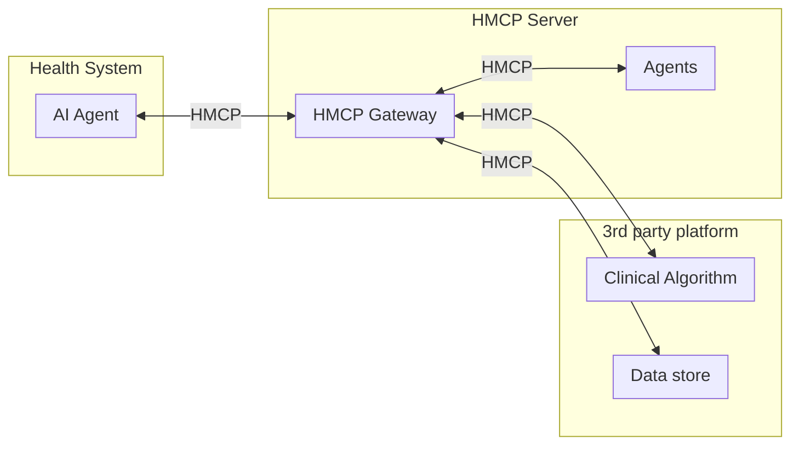

# HMCP specification

Healthcare Model Context Protocol (HMCP) is Innovaccer's open-source healthcare
extension of the base [Model Context Protocol](https://modelcontextprotocol.io/specification/2026-07-28).
HMCP **0.1.0** targets MCP spec **2026-07-28** and adds two reverse-DNS extensions plus
authentication guidance:

- **[Patient context](./patient-context.md):** extension identifier
  `com.innovaccer/hmcp-patient-context`, revision `"1"`.
- **[Guardrails](./guardrails.md):** extension identifier
  `com.innovaccer/hmcp-guardrails`, revision `"1"`.
- **[Authentication and scopes](./auth.md):** how HMCP uses the base-spec
  [authorization](https://modelcontextprotocol.io/specification/2026-07-28/basic/authorization.md)
  framework (SMART on FHIR).

The SDK is published as `innovaccer-hmcp` (import name `hmcp`): `pip install
innovaccer-hmcp`. To install from a source checkout, `pip install -e ".[dev]"`.

Base-spec extensions are opt-in: a server advertises the ones it supports in
[`server/discover`](https://modelcontextprotocol.io/specification/2026-07-28/server/discover),
and a client declares the ones it supports per request in
`_meta["io.modelcontextprotocol/clientCapabilities"].extensions`. See the MCP
[extension negotiation](https://modelcontextprotocol.io/specification/2026-07-28/basic/versioning.md#extension-negotiation)
rules. In HMCP, the patient-context interceptor runs even when a client does not declare
the extension, so omitting the declaration does not bypass it (**SDK behavior**).

## Changes from 0.0.x

HMCP 0.0.x documented bidirectional agent-to-agent communication through MCP
**sampling** and supported the HTTP+SSE transport. MCP 2026-07-28 removed protocol
sessions and the initialize handshake and deprecated sampling, and HMCP 0.1.0 removes
both features: `@server.sampling()`, `HMCPClient` and `create_message` no longer exist,
and HTTP+SSE is rejected (the client is streamable-HTTP only). HMCP's session concept is
now the [patient context](./patient-context.md), referenced explicitly on every request
instead of being inferred from connection state. See
[Migrating to 0.1](./migration-0.1.md) for the replacement patterns (tools, Tasks and
MRTR elicitation, streamable-HTTP) and the API changes.

## Patient context

There are no MCP sessions in 2026-07-28; every request is self-contained. HMCP's session
concept is the **patient context**: a server-minted, opaque handle that the host (never
the model) opens through extension methods, is bound to the authenticated principal, and
that every patient-scoped tool call carries in request
`_meta["com.innovaccer/hmcp-patient-context"]`. Patient-scoped tools fail closed without a
usable context.

[Patient Context](./patient-context.md)

## Guardrails

HMCP guardrails run as an extension, inside the patient-context extension, so they always
see the resolved patient context. They inspect tool input and output, report a verdict for
each guardrail in the result `_meta`, and can require a guardrail the server cannot apply.
The definition schema, evaluator kinds, actions, negotiation and reference guardrails are
specified in:

[Guardrails](./guardrails.md)

## Authentication and scopes

HMCP implements OAuth 2.0 and OpenID Connect following the SMART on FHIR authorization
framework model, on top of the base-spec
[authorization](https://modelcontextprotocol.io/specification/2026-07-28/basic/authorization.md)
framework. HMCP 0.1.0 enforces RFC 8707 audience binding by default when an
`AuthSettings` object is supplied.

For detailed implementation examples and flows, see the
[Authentication Implementation Guide](./auth.md), and for how HMCP authentication differs
from base MCP authentication, see
[Comparison of MCP vs HMCP Authentication](./hmcp_auth_vs_mcp_auth.md).

## Error codes

HMCP error codes are allocated **outside** the JSON-RPC reserved range
(`-32768`..`-32000`), as the base spec recommends for application-defined errors. Each
`hmcp_error()` carries the numeric code plus a `data.hmcpCode` string naming the
`HMCPErrorCode`. Messages are short and generic; they never contain a patient reference,
an identifier, a tool argument or a token.

| Code | `HMCPErrorCode` | Meaning |
| --- | --- | --- |
| `-31001` | `PATIENT_CONTEXT_REQUIRED` | A patient-scoped tool was called without a `contextId`. |
| `-31002` | `PATIENT_CONTEXT_INVALID` | The context is unknown, expired, closed, or bound to another principal. |
| `-31003` | `PATIENT_CONTEXT_REVOKED` | The context was revoked. |
| `-31004` | `PATIENT_CONTEXT_SUSPENDED` | The context is suspended (access under review). |
| `-31005` | `PATIENT_NOT_AUTHORIZED` | Opening the context was denied, or the token's patient claim does not match. |
| `-31006` | `PATIENT_CONTEXT_UNAVAILABLE` | A store, policy or audit failure; the server fails closed. |
| `-31011` | `GUARDRAIL_UNAVAILABLE` | A client required a guardrail the server cannot apply. |

The base spec requires request `_meta` for per-request protocol fields and reserves the
`io.modelcontextprotocol/` prefix; HMCP's `_meta` keys use the vendor prefix
`com.innovaccer/`. See the MCP
[`_meta`](https://modelcontextprotocol.io/specification/2026-07-28/basic.md#_meta)
definition. The 2026-07-28 revision is
[stateless](https://modelcontextprotocol.io/specification/2026-07-28/basic.md#statelessness):
no protocol sessions and no initialize handshake.

## Architecture components

### Diagram

## Examples

Runnable examples are provided under `examples/`:

- [examples/ehr_patient_context](../../examples/ehr_patient_context/): a server and
  client exercising patient context and guardrails end to end.
- [examples/custom_guardrails](../../examples/custom_guardrails/): defining and
  enforcing a custom guardrail.
- [examples/quickstart](../../examples/quickstart/): a minimal end-to-end
  walk-through whose README Quick Start is kept in step with the top-level README by
  a drift test.
